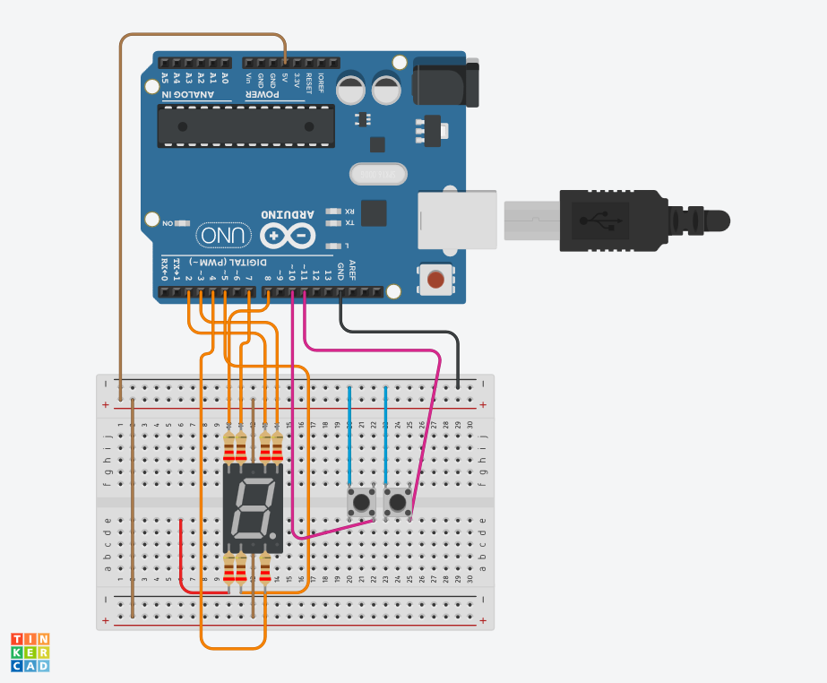
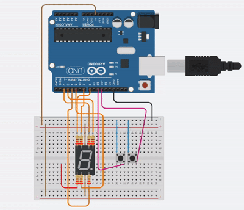

# Sorteador de Números com Arduino

Projeto desenvolvido na unidade curricular de **Sistemas Embarcados**, utilizando Arduino Uno, display de 7 segmentos e dois botões para realizar o sorteio de números aleatórios.

## Componentes utilizados
- Arduino Uno
- Display de 7 segmentos (ânodo comum)
- 2 botões
- Resistores
- Protoboard
- Jumpers

## Funcionamento

O sistema utiliza dois botões:

- **Botão 1:** liga ou desliga o sistema, iniciando ou interrompendo a animação.
- **Botão 2:** interrompe a animação e exibe um número aleatório de 0 a 9 no display.

Durante a animação, números aleatórios são exibidos rapidamente no display.

## Montagem do projeto

## Demonstração

[▶ Assistir ao vídeo completo](Sorteador.mp4)

## Código-fonte

O código completo está disponível no arquivo [Sorteador.ino](Sorteador.ino).